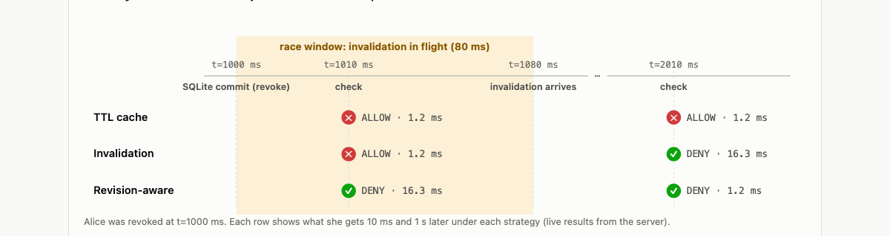

# Stale Permissions: Three Strategies, Three Trade-offs

**Goal: a showcase that compares strategies for stopping a permission cache from serving stale ALLOWs after access is revoked. For each one it shows what it fixes, what it can't promise, and what it costs.**

[](https://github.com/poorkenny/authz-lab/actions/workflows/ci.yml)
[](https://render.com/deploy?repo=https://github.com/poorkenny/authz-lab)


```
client → Check API → permission cache → primary store (SQLite)
admin  ───────────────────────────────→ primary store (grant / revoke)
```

Permission checks are cached for speed. When an admin revokes access in SQLite, any cached ALLOW for that user becomes wrong. How long can it keep being served?

| | 1 · TTL cache (naive) | 2 · TTL + invalidation on write | 3 · Revision-aware fallback |
|---|---|---|---|
| **How** | Cache until the TTL expires; writes don't touch the cache | After each SQLite commit, publish an invalidation; the cache drops the entry when it arrives | Entries stamped with their revision; requests carry the doc's revision token; older entries fall back to SQLite |
| **Stale window** | Up to the full TTL (5 min here) | Commit → invalidation arrival (80 ms here; longer under load; until the TTL if the message is lost) | **None** |
| **Read latency** | 1.2 ms hit · 16.3 ms miss | 1.2 ms hit · 16.3 ms miss after an invalidation | 1.21 ms hit · 16.31 ms fallback, once per change |
| **Write cost** | None | Publish an invalidation per write (async) | Bump the doc's token in the same SQLite transaction |
| **Needs** | Nothing | Pub/sub to every cache node | Revision tokens propagated with requests (like Zanzibar zookies) |
| **Guarantee** | ✕ None | ! Best effort: mitigates, can't promise freshness | ✓ Every decision reflects at least the doc's latest ACL change |

---

## Interactive demonstration

The same four-step story runs under the strategy you pick:

1. **Alice opens doc:42**: cache miss → SQLite → ALLOW cached at rev 3.
2. **1 s later, the admin revokes Alice**: committed in SQLite at rev 4.
3. **Alice retries 10 ms later**: inside the invalidation's 80 ms propagation window.
4. **Alice retries 1 s later**: after the invalidation has arrived.

The data-flow diagram replays every request hop by hop, **with the latency of each hop**. The primary → cache edge shows the invalidation state (none, in flight with its arrival time, or not needed), and stale cache entries are flagged in red.


The page also runs the story for all three strategies side by side:


| Strategy | 10 ms after revoke | 1 s after revoke | Verdict |
|---|---|---|---|
| TTL cache | ✕ ALLOW (cache, 1.2 ms) | ✕ ALLOW (cache, 1.2 ms) | stale until TTL |
| TTL + invalidation | ✕ ALLOW (cache, 1.2 ms) | ✓ DENY (SQLite, 16.3 ms) | mitigated: stale inside the window |
| Revision-aware | ✓ DENY (SQLite fallback, 16.3 ms) | ✓ DENY (cache, 1.2 ms) | always fresh |

## Why invalidation can't promise freshness



- The SQLite commit and the cache update are **two separate events**. No transaction spans the database and the cache, so there is always a gap between them.
- Network delay, queueing, retries and GC pauses stretch the gap. A lost message stretches it to the full TTL.
- With several cache nodes, each has its own gap. Invalidating *before* the commit doesn't help either: a concurrent read can refill the old value.
- The window can be made smaller, but in a distributed system it can't be made zero. Any check that lands inside it gets the old answer.

**Revision-aware fallback** decides freshness on the read path instead:

```
required = doc.revisionToken          // bumped in the same SQLite transaction
entry    = cache.get(user, doc)

if entry and entry.rev >= required:
    return entry.decision             // fast path: fresh enough

decision = sqlite.check(user, doc)    // fallback: source of truth
cache.put(user, doc, decision, rev = sqlite.rev)
return decision
```

The request carries the revision it needs, so correctness no longer depends on *when* a message arrives.

## Correctness tests

**Run correctness tests** on the page executes `demo.RunSuite()` on the server. CI runs the same code via `go test ./internal/demo`.


| Test | Strategy | What it proves |
|---|---|---|
| TTL cache serves a stale ALLOW for the whole TTL | TTL | the problem is real (passes when reproduced) |
| Invalidation still serves a stale ALLOW inside the race window | Invalidation | the window exists |
| Invalidation fixes the cache once it arrives | Invalidation | it mitigates |
| Revision-aware is correct even inside the race window | Revision-aware | the fallback closes the window |
| Revision-aware pays the fallback once, then hits the cache again | Revision-aware | the cost is bounded |
| A re-grant is visible immediately | Revision-aware | stale DENYs are refused too |
| Revision-aware decisions always match SQLite | property | 30 seeds × 400 random ops: **0 wrong** |
| Invalidation mitigates, but cannot eliminate, stale decisions | property | far fewer mistakes than TTL, all inside an invalidation window |
| The same workloads catch the TTL cache | property | the property test can actually fail |

Property-test results (identical workloads, requests 0–40 ms apart):

| | TTL | Invalidation | Revision-aware |
|---|---|---|---|
| wrong decisions | 2,726 | 235 (all inside an invalidation window) | **0** |
| cache hit rate | 98.4% | 81.3% | 81.4% |
| mean check latency | 1.44 ms | 4.02 ms | 4.02 ms |

Invalidation and revision-aware cost about the same (both re-read SQLite after a change). The difference is the guarantee.

---

## Run locally

Requirements: Go 1.25+, Node 22+. SQLite is embedded (pure-Go driver `modernc.org/sqlite`, no CGO), so nothing else needs installing.

```bash
make build && ./bin/authz-lab   # UI + API on http://localhost:8080
make test                        # go vet, Go tests (the correctness suite), TS typecheck
```

For development with hot reload: `make dev-api` (backend on :8080), then `make dev-ui` (Vite on :5173, proxies `/api`). With Docker: `make docker-run`, then open http://localhost:10000.

## API

All endpoints accept an `X-Lab-Session` header; each session has its own in-memory SQLite database, cache and simulated clock.

| Endpoint | Purpose |
|---|---|
| `GET /api/v1/state` | strategy, clock, SQLite revision, tuples, revision tokens, cache entries, in-flight invalidations |
| `POST /api/v1/strategy {strategy: "ttl" \| "invalidation" \| "revision_aware"}` | switch strategy (starts a fresh world) |
| `POST /api/v1/check {subject, object, waitMs?}` | advance the clock by `waitMs`, then check `view`. Returns decision, SQLite's answer, served-by, revisions, race-window flag and **hops with per-hop latency** |
| `POST /api/v1/grant` · `POST /api/v1/revoke {subject, object, waitMs?}` | change access in SQLite |
| `GET /api/v1/compare` | run the four-step story under every strategy |
| `POST /api/v1/reset` | restore the starting state |
| `GET /api/v1/audit?stale=true` | audit log of writes and checks |
| `POST /api/v1/tests/run` | run the correctness suite |

```bash
H='X-Lab-Session: demo'; B=http://localhost:8080
curl -s -H "$H" -X POST $B/api/v1/strategy -d '{"strategy":"invalidation"}'
curl -s -H "$H" -X POST $B/api/v1/check  -d '{"subject":"user:alice","object":"doc:42"}'
curl -s -H "$H" -X POST $B/api/v1/revoke -d '{"subject":"user:alice","object":"doc:42","waitMs":1000}'
curl -s -H "$H" -X POST $B/api/v1/check  -d '{"subject":"user:alice","object":"doc:42","waitMs":10}'    # stale: race window
curl -s -H "$H" -X POST $B/api/v1/check  -d '{"subject":"user:alice","object":"doc:42","waitMs":1000}'  # DENY: invalidated
```

---

## Deploy to Render (free tier)

The repo ships a [Render Blueprint](render.yaml) that builds the [Dockerfile](Dockerfile) (the UI is embedded in the Go binary, so it's a single web service) on the free plan with a `/healthz` health check.

### Option A: one click

1. Click **Deploy to Render** above (or open `https://render.com/deploy?repo=https://github.com/poorkenny/authz-lab`).
2. Sign in to Render (signing in with GitHub is easiest) and authorize access to the repo if asked.
3. Review the service from `render.yaml` (**authz-lab**, Docker, **Free**) and click **Apply** / **Deploy Blueprint**.
4. Wait for the first build (a few minutes). The URL appears on the dashboard, e.g. `https://authz-lab.onrender.com`.

### Option B: Blueprint from the dashboard

1. In the [Render dashboard](https://dashboard.render.com) choose **New → Blueprint**.
2. Connect GitHub and select `poorkenny/authz-lab`. Render detects `render.yaml`.
3. Click **Apply**.

### Option C: manual web service

1. **New → Web Service** → select `poorkenny/authz-lab`.
2. **Language**: Docker · **Branch**: `main` · **Dockerfile path**: `./Dockerfile` · **Instance type**: Free.
3. **Advanced → Health Check Path**: `/healthz`. No environment variables are needed (Render injects `PORT`).
4. Click **Deploy Web Service**.

### Verify

```bash
APP=https://<your-service>.onrender.com
curl -s $APP/healthz                                         # {"ok":true,...}
curl -s -X POST $APP/api/v1/tests/run | head -c 200          # {"passed":true,...}
```

### Updates and free-tier behaviour

- `autoDeploy: true`: every push to `main` redeploys (after CI passes on the PR).
- The free instance **sleeps after ~15 min idle**, and the first request then takes about a minute. Open the URL shortly before a review.
- **No persistent disk**: each session's SQLite database lives in memory and resets on restart, by design.
- Safeguards for public access: per-browser sessions (max 500, 30 min idle expiry, database closed on expiry), 10 req/s rate limit per session, 16 KB request bodies, and CSP / frame / nosniff headers.

Free-tier limits change; check [render.com/pricing](https://render.com/pricing).

---

## Project layout

```
cmd/server/        HTTP server: API + embedded UI
internal/demo/     the three strategies, simulated clock, async invalidations,
                   per-hop latency, and the correctness suite (suite.go, suite_test.go)
internal/store/    SQLite primary store: tuples, changelog (= revisions), doc revision tokens
internal/audit/    audit log
internal/api/      REST handlers, sessions, rate limiting
web/               React + TypeScript single-page UI (Vite), embedded via web/embed.go
render.yaml        Render Blueprint
```
