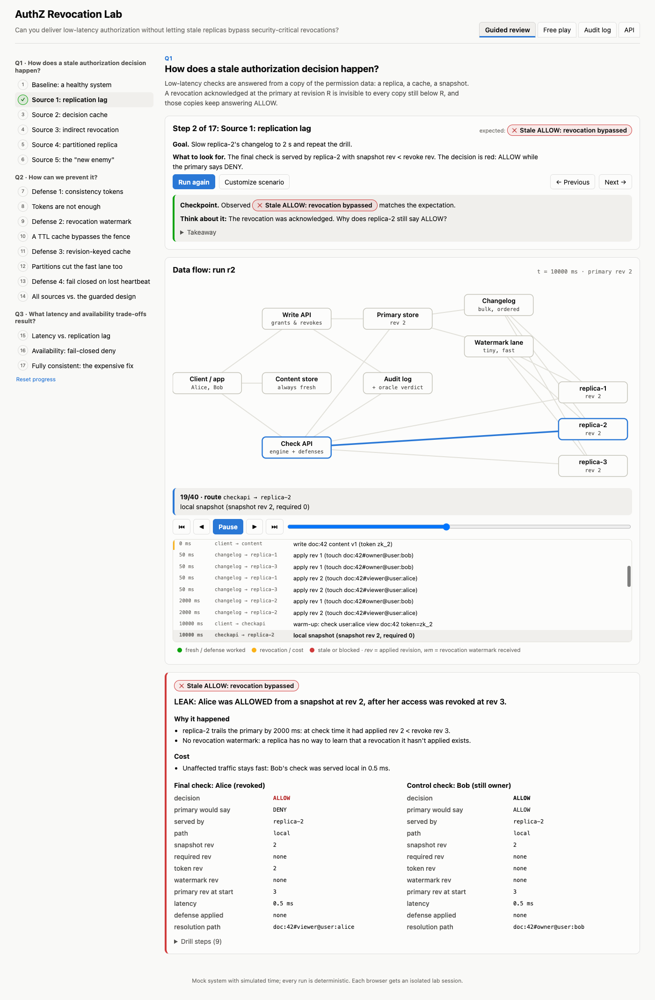
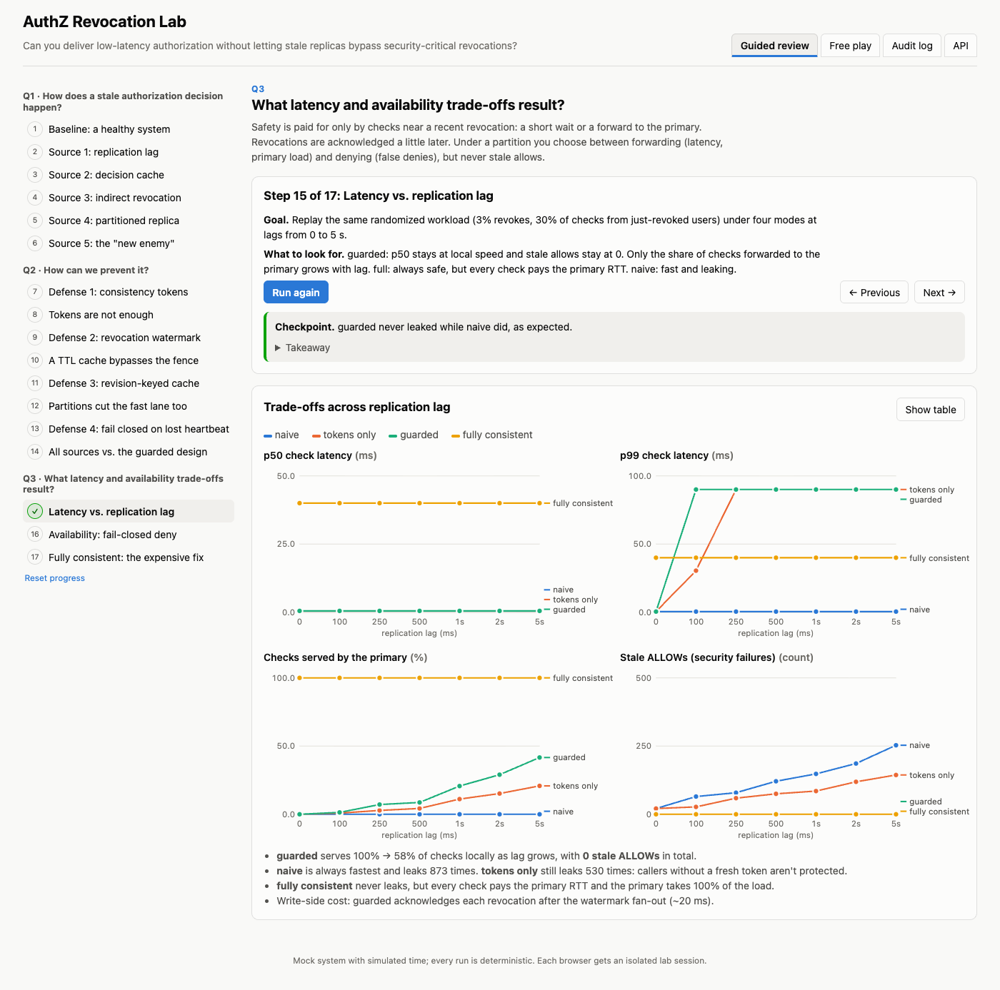
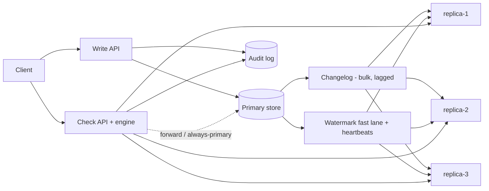

# AuthZ Revocation Lab

**Can you deliver low-latency authorization without letting stale replicas bypass security-critical revocations?**

An interactive lab that walks a reviewer through the problem and its answer, using a mock distributed authorization system (primary store, changelog, watermark fast lane, check replicas, decision caches, audit log) with simulated time, so every run is deterministic and replayable.

[](https://github.com/poorkenny/authz-lab/actions/workflows/ci.yml)
[](https://render.com/deploy?repo=https://github.com/poorkenny/authz-lab)



---

## The three questions the lab answers

### 1. How does a stale authorization decision happen?

Low-latency checks are served from a *copy* of the permission data: a replica, a cache, a snapshot. A revocation acknowledged at the primary at revision **R** is invisible to every copy still below R, and those copies keep answering ALLOW. The lab reproduces five sources, which can be combined freely:

| Source | What goes wrong |
|---|---|
| Replication lag | replica-2 applies the revoke seconds after it was acknowledged |
| Decision cache (TTL) | an ALLOW computed before the revoke is replayed until the TTL expires |
| Indirect revocation | Alice loses access via `group:eng → folder:7 → doc:42`; doc:42's own tuples never change |
| Partitioned replica | replica-2 never hears about the revoke and keeps answering confidently |
| The "new enemy" | content written *after* Alice's removal is shown to her (Zanzibar §2.2) |

### 2. How can we prevent it?

Make freshness explicit (revisions, not wall-clock time) and **fail closed**. Each defense closes a specific gap, and the lab lets you toggle them one by one:

| Defense | Closes | Gap it leaves |
|---|---|---|
| Consistency tokens (zookies) | new-enemy for content carrying a fresh token | callers holding an old token, or none |
| Revocation watermark on a fast lane, expanded to dependents | lag and indirect revocations, for *every* caller | caches, partitions |
| Revision-keyed decision cache | TTL caches serving pre-revoke ALLOWs | — |
| Heartbeat lease + fail closed (forward or deny) | partitioned replicas | — |
| Revoke acknowledged only after watermark fan-out / lease expiry | the window between commit and fence delivery | — |

The **guarded** design combines all of them. Its invariant: *no ALLOW is served from a snapshot older than a revocation acknowledged before the check began.* Every audit record carries an oracle verdict (the same check evaluated at the primary), and the randomized test suite asserts `stale ALLOWs = 0` across 20 seeds × 7 lags.

### 3. What latency and availability trade-offs result?



- **Reads**: only checks touching a *recent* revocation pay: a short wait, or a forward to the primary. p50 stays at local speed; the forwarded share grows with `revocation rate × lag`, not with total traffic.
- **Writes**: revocations are acknowledged after the watermark fan-out (~20 ms here), or after a partitioned replica's lease expires.
- **Availability**: under a partition you choose *forward* (latency and primary load) or *deny* (false denies for legitimate users), never stale allows.
- **Fully consistent** (every check reads the primary) is safe but pays the primary RTT on every check, and the primary takes 100% of the read load.

---

## What's in the box

**Web UI**
- **Guided review**: a 17-step procedure across the three questions. Each step has a goal, a "what to look for", a scored checkpoint (expected vs. observed outcome), a prompt to think about, and a takeaway. Any step's scenario can be customized.
- **Free play**: a scenario composer for any combination of staleness sources and defenses, plus timing knobs.
- **Data-flow diagram**: an animated SVG of every component. Replay a run event by event (writes, changelog deliveries, watermarks, blocked deliveries, check routing, decisions), with replica revisions and watermarks shown live.
- **Trade-off charts**: a lag sweep across four modes (naive / tokens / guarded / fully consistent), with a table view.
- **Audit log**: every write and check, filterable to stale ALLOWs, exportable as JSON.

**Backend API (mock authorization system)**
- **Data store**: relationship tuples with monotonically increasing revisions, full history, and a changelog.
- **Check engine**: ReBAC evaluation (`view = viewer + owner + parent->view`, nested groups) with every defense.
- **Audit log**: every decision with evidence (snapshot / required / watermark revision, path, latency, defense applied) and the oracle verdict.



---

## Run locally

Requirements: Go 1.25+, Node 22+.

```bash
make build && ./bin/authz-lab        # UI + API on http://localhost:8080
make test                             # go vet, Go tests (incl. randomized invariant), TS typecheck
```

For development with hot reload: `make dev-api` (backend on :8080), then `make dev-ui` (Vite on :5173, proxies `/api`).

With Docker: `make docker-run`, then open http://localhost:10000.

---

## Deploy to Render (free tier)

The repo ships a [Render Blueprint](render.yaml) that builds the [Dockerfile](Dockerfile) (the UI is embedded in the Go binary, so it's a single web service) on the free plan with a `/healthz` health check.

### Option A: one click

1. Click **Deploy to Render** at the top of this README (or open `https://render.com/deploy?repo=https://github.com/poorkenny/authz-lab`).
2. Sign in to Render (signing in with GitHub is easiest) and authorize access to the repo if asked.
3. Review the service Render reads from `render.yaml` (**authz-lab**, Docker, **Free**) and click **Apply** / **Deploy Blueprint**.
4. Wait for the first build (a few minutes: Node build, then Go build, then a distroless image). The service URL appears on the dashboard, e.g. `https://authz-lab.onrender.com` (Render adds a suffix if the name is taken).

### Option B: Blueprint from the dashboard

1. In the [Render dashboard](https://dashboard.render.com) choose **New → Blueprint**.
2. Connect GitHub and select `poorkenny/authz-lab`. Render detects `render.yaml`.
3. Click **Apply**.

### Option C: manual web service (no Blueprint)

1. **New → Web Service** → select the `poorkenny/authz-lab` repo.
2. **Language / Runtime**: Docker. **Branch**: `main`. **Dockerfile path**: `./Dockerfile`.
3. **Instance type**: Free.
4. **Advanced → Health Check Path**: `/healthz`. No environment variables are needed: Render injects `PORT`, and the server listens on it.
5. Click **Deploy Web Service**.

### Verify

```bash
APP=https://<your-service>.onrender.com
curl -s $APP/healthz                       # {"ok":true,"sessions":0}
curl -s -X POST $APP/api/v1/lab/drill -H 'X-Lab-Session: smoke' \
  -d '{"sources":{"replicationLag":{"enabled":true,"lagMs":2000}}}' | head -c 300
```

Then open `$APP` in a browser and start the **Guided review**.

### Updates

`autoDeploy: true` means every push to `main` triggers a rebuild and deploy. You can also redeploy from the dashboard (**Manual Deploy → Deploy latest commit**).

### Free-tier behaviour to know about

| Behaviour | Impact on the lab |
|---|---|
| The service **spins down after ~15 min without traffic**; the next request waits roughly a minute for a cold start | Open the URL a minute before a review session |
| **No persistent disk**; restarts and spin-downs clear memory | All lab state is in-memory and disposable by design: sessions are re-seeded automatically. Export the audit log from the UI if you want to keep it |
| 512 MB RAM, shared CPU, a monthly allowance of free instance hours | Plenty: a full lag sweep takes ~0.1 s; sessions are capped at 500 and expire after 30 min idle |

Free-tier limits change; check [render.com/pricing](https://render.com/pricing) for the current terms.

### Built-in public-access safeguards

- **Per-reviewer isolation**: every browser gets its own session (`X-Lab-Session`): its own world, replicas and audit log.
- **Rate limit**: 10 req/s per session (burst 40). Request bodies are capped at 64 KB, and experiment sizes and all simulation parameters are clamped.
- **Security headers**: CSP `default-src 'self'`, `X-Frame-Options: DENY`, `nosniff`, `no-referrer`.

---

## API

All endpoints accept the `X-Lab-Session` header (falls back to a shared `anonymous` session). Time is simulated; use `/lab/advance` to let replication progress.

| Layer | Endpoint |
|---|---|
| Data store | `GET /api/v1/tuples?object=&atRev=` · `POST /api/v1/tuples/write {writes:[{op:"touch"\|"delete", tuple:"doc:42#viewer@user:alice"}]}` → `{revision, token}` · `GET /api/v1/changelog` |
| Check engine | `POST /api/v1/check {subject, permission:"view", object, replica?, token?}` → decision + evidence + oracle verdict |
| Audit | `GET /api/v1/audit?kind=&subject=&object=&runId=&stale=true` · `GET /api/v1/audit/{id}` · `GET /api/v1/audit/export` |
| Lab | `GET /api/v1/lab/state` · `GET /api/v1/lab/timeline` · `GET\|PUT /api/v1/lab/config` · `POST /api/v1/lab/reset` · `POST /api/v1/lab/advance {ms}` · `POST /api/v1/lab/partition {replica, heal?}` · `POST /api/v1/lab/drill <Config>` · `POST /api/v1/lab/experiments/lag-sweep` |

Reproduce a stale ALLOW by hand:

```bash
H='X-Lab-Session: demo'; B=http://localhost:8080
curl -s -H "$H" -X POST $B/api/v1/lab/reset
curl -s -H "$H" -X PUT  $B/api/v1/lab/config -d '{"sources":{"replicationLag":{"enabled":true,"lagMs":3000}}}'
curl -s -H "$H" -X POST $B/api/v1/tuples/write -d '{"writes":[{"op":"delete","tuple":"doc:42#viewer@user:alice"}]}'
curl -s -H "$H" -X POST $B/api/v1/check -d '{"subject":"user:alice","permission":"view","object":"doc:42","replica":"replica-2"}'
# → "decision":"ALLOW", "oracleDecision":"DENY", "stale":true
```

---

## Project layout

```
cmd/server/          HTTP server; serves the API and the embedded UI
internal/store/      primary tuple store: revisions, history, changelog, revocation impact analysis
internal/engine/     ReBAC check evaluation at any revision
internal/sim/        replicas, fast lane, caches, defenses, check routing, event timeline
internal/lab/        revocation drill, verdict explanations, lag-sweep experiment, sessions
internal/audit/      bounded audit log with oracle verdicts
internal/api/        REST handlers, session scoping, rate limiting
web/                 React + TypeScript UI (Vite), embedded via web/embed.go
render.yaml          Render Blueprint (free Docker web service)
```

## Modelling notes and limits

- **Simulated time**: deliveries are computed from commit time + per-replica lag, so the state at any instant is exact and reproducible. Latencies are modelled (local 0.5 ms, cache 0.1 ms, primary RTT 40 ms by default, all adjustable).
- **The oracle** is the primary at the check's start revision. A check is *stale* if it ALLOWs what the oracle DENYs, and a *false deny* if it DENYs what the oracle ALLOWs.
- **Watermarks** are expanded at write time to every object whose `view` could shrink (nested groups and parent folders). Per-namespace granularity is available as a cheaper, coarser alternative.
- Not modelled yet: out-of-order changelog delivery, clock-skew-based bounded staleness, primary failover, multi-region RTTs.
