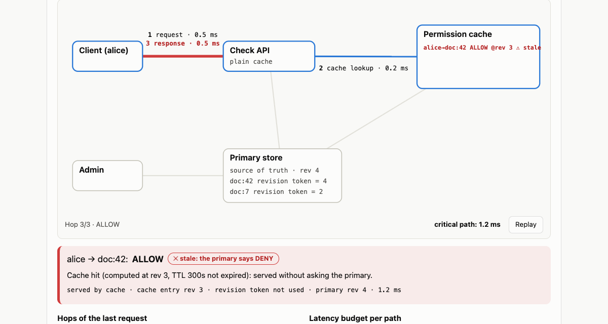
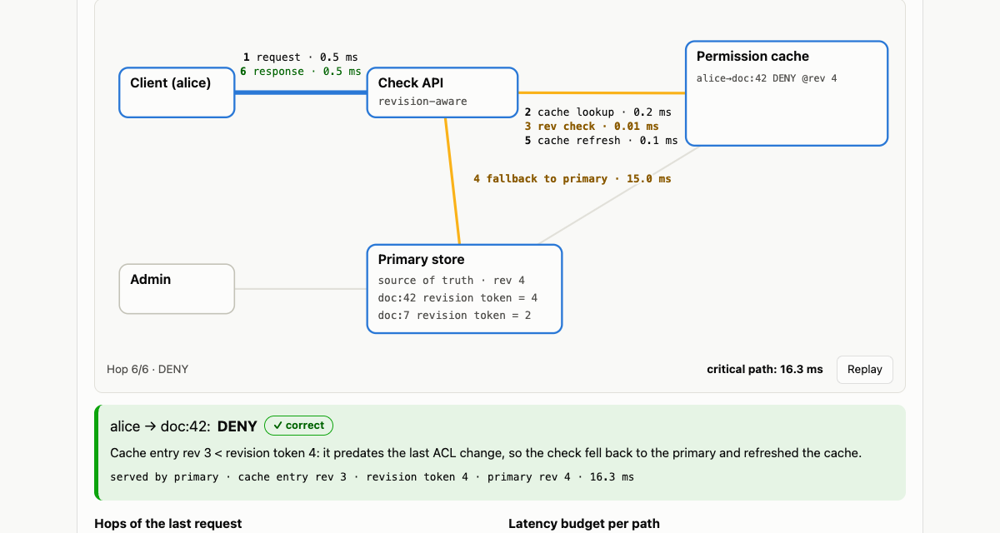
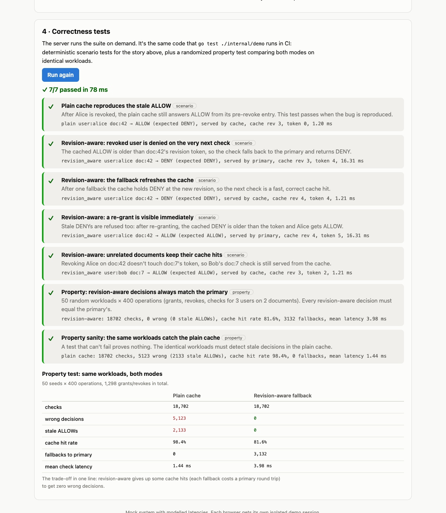

# Stale Cache Revocation Demo

**Can you deliver low-latency authorization without letting a stale cache bypass a revocation?**

A small interactive demo of one problem and one fix:

1. **The problem**: one stale permission cache keeps answering ALLOW after a user's access is revoked.
2. **The fix**: a **revision-aware fallback** refuses cache entries older than the document's revision token and falls back to the primary store.
3. **Interactive demonstration**: run the story step by step in both modes and watch every hop, with its latency, on the data-flow diagram.
4. **Correctness tests**: run the test suite from the page. It's the same suite CI runs.

[](https://github.com/poorkenny/authz-lab/actions/workflows/ci.yml)
[](https://render.com/deploy?repo=https://github.com/poorkenny/authz-lab)

---

## 1. The problem: one stale cache

```
client → Check API → permission cache → primary store
                          ✕  invalidation lost
admin  ──────────────────────────────→ primary store (revoke committed)
```

Checks are cached so they're fast. When the admin revokes Alice, the cache should be invalidated, but invalidations get lost or delayed. Until the TTL expires (5 minutes here), the cache keeps answering **ALLOW**.



## 2. The fix: revision-aware fallback

```
required = doc.revisionToken          // revision of the doc's last ACL change
entry    = cache.get(user, doc)

if entry and entry.rev >= required:
    return entry.decision             // fast path: fresh enough

decision = primary.check(user, doc)   // fallback: source of truth
cache.put(user, doc, decision, rev = primary.rev)
return decision
```

- Every cache entry is stamped with the store **revision** it was computed at.
- Every ACL change gives the document a new **revision token**, which travels with requests (like a Zanzibar *zookie*).
- An entry older than the token is never served, even when the invalidation was lost and the TTL hasn't expired.



### The latency trade-off

Each hop is modelled and shown on the diagram:

| Path | Hops | Critical path |
|---|---|---|
| Plain cache hit | request 0.5 + cache lookup 0.2 + response 0.5 | **1.2 ms** |
| Revision-aware hit (entry fresh) | + revision check 0.01 | **1.21 ms** |
| Revision-aware fallback (entry stale) | + primary 15 + cache refresh 0.1 | **16.31 ms** |
| Cache miss (either mode) | request + lookup + primary + refresh + response | 16.3 ms |

The revision check itself is nearly free. The cost is the fallback, and only the first check after an ACL change pays it, because the fallback refreshes the cache. Over the randomized workload below, revision-aware gives up some cache hit rate (98.4% → 81.6%) and mean latency (1.44 → 3.98 ms) in exchange for **zero wrong decisions** (vs. 5,123 for the plain cache).

## 3. Interactive demonstration

The page walks through the story in three steps:

1. **Alice opens doc:42**: cache miss, evaluated at the primary, ALLOW cached at rev 3.
2. **Admin revokes Alice**: committed at rev 4; doc:42's token becomes 4; the invalidation is lost.
3. **Alice opens doc:42 again**: the plain cache answers **ALLOW (stale)** in 1.2 ms. Revision-aware sees `entry rev 3 < token 4`, falls back, and answers **DENY** in 16.3 ms.

Switch modes and repeat: a comparison table shows step 3 in both modes. The diagram replays each request hop by hop with per-hop latency, the cache shows stale entries in red, and "Explore freely" lets you grant, revoke and check any user/document.

## 4. Correctness tests



**Run correctness tests** on the page executes `demo.RunSuite()` on the server. CI runs the same code via `go test ./internal/demo`:

| Test | Kind | What it proves |
|---|---|---|
| Plain cache reproduces the stale ALLOW | scenario | the bug is real (passes when reproduced) |
| Revoked user is denied on the very next check | scenario | the fallback fixes it |
| The fallback refreshes the cache | scenario | the cost is paid once |
| A re-grant is visible immediately | scenario | stale DENYs are refused too |
| Unrelated documents keep their cache hits | scenario | the fix is scoped per document |
| Revision-aware decisions always match the primary | property | 50 seeds × 400 random ops: 0 wrong decisions |
| The same workloads catch the plain cache | property | the property test can actually fail |

---

## Run locally

Requirements: Go 1.25+, Node 22+.

```bash
make build && ./bin/authz-lab   # UI + API on http://localhost:8080
make test                        # go vet, Go tests (the correctness suite), TS typecheck
```

For development with hot reload: `make dev-api` (backend on :8080), then `make dev-ui` (Vite on :5173, proxies `/api`). With Docker: `make docker-run`, then open http://localhost:10000.

## API

All endpoints accept an `X-Lab-Session` header; each session has its own store, cache and audit log.

| Endpoint | Purpose |
|---|---|
| `GET /api/v1/state` | mode, primary revision, tuples, revision tokens, cache entries |
| `POST /api/v1/mode {mode: "plain" \| "revision_aware"}` | switch the Check API mode |
| `POST /api/v1/check {subject, object}` | check `view`; returns decision, expected decision, served-by, revisions, **hops with per-hop latency** |
| `POST /api/v1/grant` · `POST /api/v1/revoke {subject, object}` | change access (the cache is never invalidated) |
| `POST /api/v1/reset` | restore the starting state |
| `GET /api/v1/audit?stale=true` | audit log of writes and checks |
| `POST /api/v1/tests/run` | run the correctness suite |

```bash
H='X-Lab-Session: demo'; B=http://localhost:8080
curl -s -H "$H" -X POST $B/api/v1/check  -d '{"subject":"user:alice","object":"doc:42"}'
curl -s -H "$H" -X POST $B/api/v1/revoke -d '{"subject":"user:alice","object":"doc:42"}'
curl -s -H "$H" -X POST $B/api/v1/check  -d '{"subject":"user:alice","object":"doc:42"}'   # stale ALLOW
curl -s -H "$H" -X POST $B/api/v1/mode   -d '{"mode":"revision_aware"}'
curl -s -H "$H" -X POST $B/api/v1/check  -d '{"subject":"user:alice","object":"doc:42"}'   # DENY via fallback
```

---

## Deploy to Render (free tier)

The repo ships a [Render Blueprint](render.yaml) that builds the [Dockerfile](Dockerfile) (the UI is embedded in the Go binary, so it's a single web service) on the free plan with a `/healthz` health check.

### Option A: one click

1. Click **Deploy to Render** above (or open `https://render.com/deploy?repo=https://github.com/poorkenny/authz-lab`).
2. Sign in to Render (signing in with GitHub is easiest) and authorize access to the repo if asked.
3. Review the service from `render.yaml` (**authz-lab**, Docker, **Free**) and click **Apply** / **Deploy Blueprint**.
4. Wait for the first build (a few minutes). The URL appears on the dashboard, e.g. `https://authz-lab.onrender.com`.

### Option B: Blueprint from the dashboard

1. In the [Render dashboard](https://dashboard.render.com) choose **New → Blueprint**.
2. Connect GitHub and select `poorkenny/authz-lab`. Render detects `render.yaml`.
3. Click **Apply**.

### Option C: manual web service

1. **New → Web Service** → select `poorkenny/authz-lab`.
2. **Language**: Docker · **Branch**: `main` · **Dockerfile path**: `./Dockerfile` · **Instance type**: Free.
3. **Advanced → Health Check Path**: `/healthz`. No environment variables are needed (Render injects `PORT`).
4. Click **Deploy Web Service**.

### Verify

```bash
APP=https://<your-service>.onrender.com
curl -s $APP/healthz                                         # {"ok":true,...}
curl -s -X POST $APP/api/v1/tests/run | head -c 200          # {"passed":true,...}
```

### Updates and free-tier behaviour

- `autoDeploy: true`: every push to `main` redeploys (after CI passes on the PR).
- The free instance **sleeps after ~15 min idle**, and the first request then takes about a minute. Open the URL shortly before a review.
- **No persistent disk**: demo state is in memory and resets on restart, by design.
- Safeguards for public access: per-browser sessions (max 500, 30 min idle expiry), 10 req/s rate limit per session, 16 KB request bodies, and CSP / frame / nosniff headers.

Free-tier limits change; check [render.com/pricing](https://render.com/pricing).

---

## Project layout

```
cmd/server/        HTTP server: API + embedded UI
internal/demo/     the model: store → stale cache → check API, revision-aware fallback,
                   per-hop latency, and the correctness suite (suite.go, suite_test.go)
internal/store/    revisioned relationship-tuple store
internal/engine/   permission evaluation at a revision
internal/audit/    audit log
internal/api/      REST handlers, sessions, rate limiting
web/               React + TypeScript single-page UI (Vite), embedded via web/embed.go
render.yaml        Render Blueprint
```
