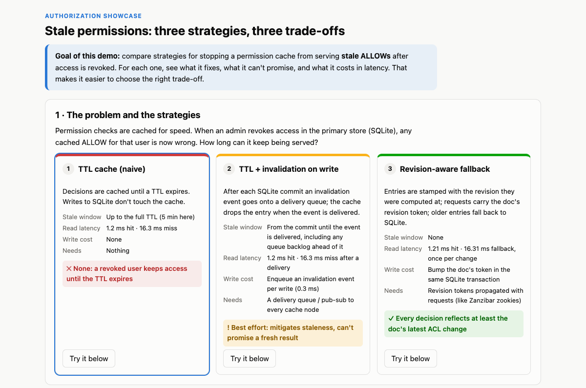
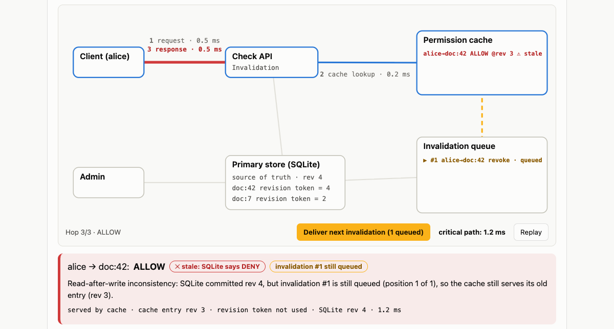
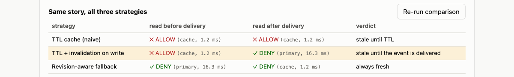
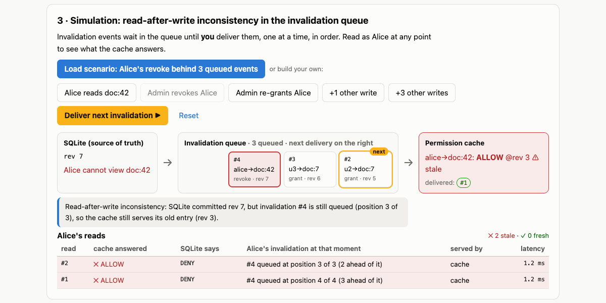
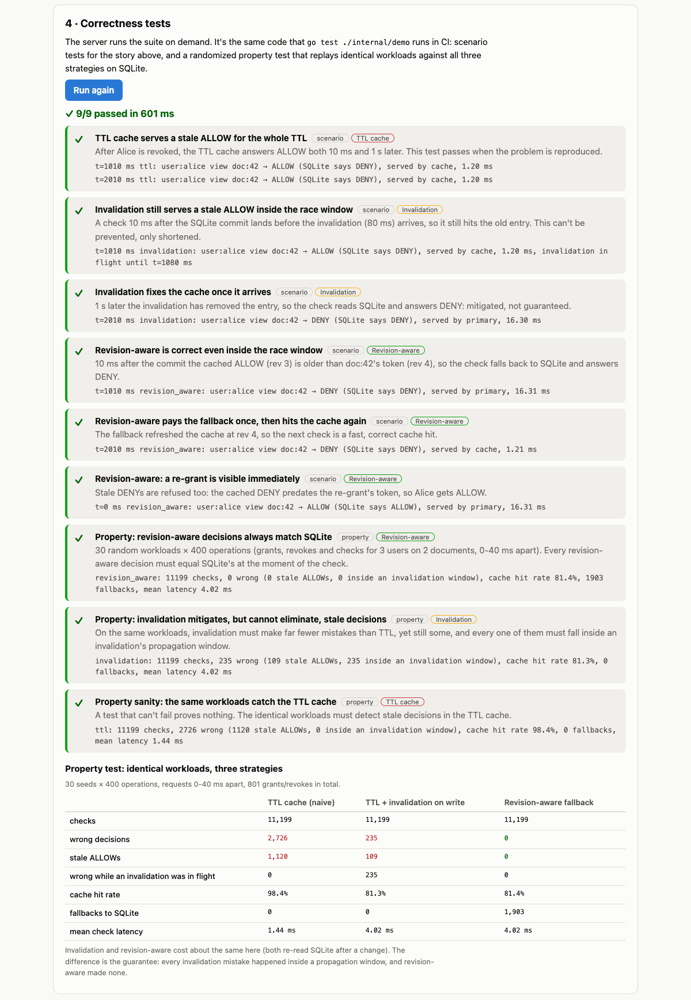

# Stale Permissions: Three Strategies, Three Trade-offs

**Goal: a showcase that compares strategies for stopping a permission cache from serving stale ALLOWs after access is revoked. For each one it shows what it fixes, what it can't promise, and what it costs.**

[](https://github.com/poorkenny/authz-lab/actions/workflows/ci.yml)
[](https://render.com/deploy?repo=https://github.com/poorkenny/authz-lab)



```
client → Check API → permission cache → primary store (SQLite)
admin  ───────────────────────────────→ primary store (grant / revoke)
```

Permission checks are cached for speed. When an admin revokes access in SQLite, any cached ALLOW for that user becomes wrong. How long can it keep being served?

| | 1 · TTL cache (naive) | 2 · TTL + invalidation on write | 3 · Revision-aware fallback |
|---|---|---|---|
| **How** | Cache until the TTL expires; writes don't touch the cache | After each SQLite commit, an invalidation event goes onto a delivery queue; the cache drops the entry when it is delivered | Entries stamped with their revision; requests carry the doc's revision token; older entries fall back to SQLite |
| **Stale window** | Up to the full TTL (5 min here) | From the commit until the event is delivered, including any backlog ahead of it | **None** |
| **Read latency** | 1.2 ms hit · 16.3 ms miss | 1.2 ms hit · 16.3 ms miss after a delivery | 1.21 ms hit · 16.31 ms fallback, once per change |
| **Write cost** | None | Enqueue an invalidation event per write (0.3 ms) | Bump the doc's token in the same SQLite transaction |
| **Needs** | Nothing | A delivery queue / pub-sub to every cache node | Revision tokens propagated with requests (like Zanzibar zookies) |
| **Guarantee** | ✕ None | ! Best effort: mitigates, can't promise freshness | ✓ Every decision reflects at least the doc's latest ACL change |

---

## Interactive demonstration

Each strategy has its own story (flag `FEATURE_STRATEGY_STORIES`). Every run is deterministic: **invalidation events are delivered only when you click**, and TTL expiry runs on a simulated clock that you fast-forward.

| Step | TTL cache | TTL + invalidation | Revision-aware |
|---|---|---|---|
| 1 | Alice opens doc:42: cache miss → SQLite → ALLOW cached at rev 3 | same | same |
| 2 | Admin revokes Alice (SQLite rev 4); nothing tells the cache | Admin revokes Alice; invalidation #1 is queued | Admin revokes Alice; doc:42's revision token becomes 4 |
| 3 | **Alice reads within the TTL** (repeatable): stale ALLOW; the freshness panel shows the entry's age and time left | **Check before delivery** (repeatable, also as Bob): each read shows its result **next to the happy path** (event delivered first) | Alice reads after the revoke: fallback to SQLite, DENY |
| 4 | **Fast-forward 300 s**: the entry reaches its TTL and is evicted | **Deliver the invalidation event** (manual) | Alice reads again: fresh cache hit |
| 5 | Alice reads after the TTL: DENY from SQLite | Alice reads after delivery: DENY from SQLite | |

The TTL story has no delivery step, because the TTL strategy sends no invalidations. Instead, the **Cache TTL and freshness** panel shows the TTL config (300 s), the simulated clock and, for every cache entry, the revision it was cached at, SQLite's current revision for the document, its age, the time left before it expires, and whether it is fresh or stale.

With the invalidation strategy, a read made while the user's invalidation is still queued puts **this read** (stale ALLOW from the cache, 1.2 ms) next to **the happy path** (the event delivered before the read: DENY from SQLite, 16.3 ms), so the incorrect and the correct result are visible side by side (flag `FEATURE_HAPPY_PATH_COMPARISON`).

The data-flow diagram replays every request hop by hop, **with the latency of each hop**. It includes the invalidation queue node, which lists the queued events and, for the invalidation strategy, has a **Deliver next invalidation** button.



The page also runs the story for all three strategies side by side:



| Strategy | Read before delivery | Read after delivery / TTL expiry | Verdict |
|---|---|---|---|
| TTL cache | ✕ ALLOW (cache, 1.2 ms) | ✓ DENY (SQLite after the TTL, 16.3 ms) | stale until TTL |
| TTL + invalidation | ✕ ALLOW (cache, 1.2 ms) | ✓ DENY (SQLite, 16.3 ms) | stale until the event is delivered |
| Revision-aware | ✓ DENY (SQLite fallback, 16.3 ms) | ✓ DENY (cache, 1.2 ms) | always fresh |

## Simulation: read-after-write inconsistency in the invalidation queue

A separate world (always the invalidation strategy) where you control the delivery queue directly: Alice reads, admin revokes / re-grants Alice, unrelated writes (+1 / +3) that queue their own events, and **Deliver next invalidation**, one event at a time in FIFO order. Every read records where Alice's invalidation sat in the queue at that moment.

**Load scenario** puts Alice's revoke behind 3 queued events:



| Alice's read | Cache answered | SQLite says | Alice's invalidation at that moment |
|---|---|---|---|
| before any delivery | ✕ ALLOW | DENY | #4 queued at position 4 of 4 |
| after 1 delivery | ✕ ALLOW | DENY | #4 queued at position 3 of 3 |
| after 3 deliveries | ✕ ALLOW | DENY | #4 queued at position 1 of 1 |
| after 4 deliveries | ✓ DENY | DENY | none queued (read from SQLite) |

## Correctness tests

**Run correctness tests** on the page executes `demo.RunSuite()` on the server. CI runs the same code via `go test ./internal/demo`.



| Test | Strategy | What it proves |
|---|---|---|
| TTL cache serves a stale ALLOW until the TTL expires | TTL | the problem is real (passes when reproduced) |
| The stale window ends when the entry's TTL runs out | TTL | stale within the TTL, fresh after fast-forwarding 300 s |
| An entry is served until exactly its TTL | TTL | frozen clock: still served at 299 s, evicted at 300 s |
| A read right after the write is stale while the event is queued | Invalidation | read-after-write inconsistency |
| Delivering the event fixes the cache | Invalidation | it mitigates |
| A read before delivery reports the happy-path result next to its own | Invalidation | stale ALLOW alongside the happy-path DENY; nothing to compare after delivery |
| A queue backlog stretches the inconsistency | Invalidation | stale through 3 deliveries, fresh only after her own |
| Revision-aware is correct before any delivery | Revision-aware | no invalidation needed |
| Revision-aware pays the fallback once, then hits the cache again | Revision-aware | the cost is bounded |
| Revision-aware decisions always match SQLite | property | 30 seeds × 400 random ops: **0 wrong** |
| Invalidation mitigates, but cannot eliminate, stale decisions | property | far fewer mistakes than TTL, every one while the user's event was queued |
| The same workloads catch the TTL cache | property | the property test can actually fail |

Property-test results (identical seeded workloads of grants, revokes, deliveries and checks):

| | TTL | Invalidation | Revision-aware |
|---|---|---|---|
| wrong decisions | 2,579 | 361 (all while the user's event was queued) | **0** |
| cache hit rate | 98.0% | 90.6% | 78.1% |
| mean check latency | 1.50 ms | 2.62 ms | 4.51 ms |

Invalidation looks cheaper than revision-aware because it keeps serving cached entries until their event is delivered. Those are exactly the reads where it was wrong. Revision-aware pays an extra SQLite round trip right after each change and is never wrong.

---

## Feature flags

Every feature ships behind a flag; see **[docs/FEATURES.md](docs/FEATURES.md)** for the full list, what each flag does on/off, and how to toggle it locally, in Docker and on Render.

| Flag | Default | Feature |
|---|---|---|
| `FEATURE_CONTROLLED_CACHE_DELIVERY` | `true` | Invalidation events wait in the queue until delivered from the UI (deliver step, queue button, section 3 simulation). Off: delivered automatically after each commit. |
| `FEATURE_STRATEGY_STORIES` | `true` | Each strategy gets its own story. TTL: no delivery step; entries expire on a simulated clock, with a TTL and freshness panel and a fast-forward step. Off: one shared story for all strategies. |
| `FEATURE_HAPPY_PATH_COMPARISON` | `true` | An invalidation read made while its event is queued also returns the happy-path result, shown side by side. Off: only the read's own result. |
| `FEATURE_AUTH` | `false` | *Planned*: authentication and user management (see [TODO.md](TODO.md)). |

## Run locally

Requirements: Go 1.25+, Node 22+. SQLite is embedded (pure-Go driver `modernc.org/sqlite`, no CGO), so nothing else needs installing.

```bash
make build && ./bin/authz-lab   # UI + API on http://localhost:8080
make test                        # go vet, Go tests (the correctness suite), TS typecheck
```

For development with hot reload: `make dev-api` (backend on :8080), then `make dev-ui` (Vite on :5173, proxies `/api`). With Docker: `make docker-run`, then open http://localhost:10000.

## API

All endpoints accept an `X-Lab-Session` header. Each session has two worlds, each with its own in-memory SQLite database, cache and invalidation queue: the main demo (`/api/v1/...`) and the queue simulation (`/api/v1/sim/...`, always the invalidation strategy).

| Endpoint | Purpose |
|---|---|
| `GET /api/v1/features` | active feature flags (see [docs/FEATURES.md](docs/FEATURES.md)) |
| `GET /api/v1/state` | strategy, SQLite revision, tuples, revision tokens, cache entries (with age and time left), TTL config, simulated clock, queued + recently delivered invalidations |
| `POST /api/v1/strategy {strategy: "ttl" \| "invalidation" \| "revision_aware"}` | switch strategy (starts a fresh world) |
| `POST /api/v1/check {subject, object}` | check `view`. Returns decision, SQLite's answer, served-by, revisions, the user's queued invalidation (position in queue), the entry's age, **hops with per-hop latency** and, while the invalidation is queued, the `happyPath` result (flag `FEATURE_HAPPY_PATH_COMPARISON`) |
| `POST /api/v1/grant` · `POST /api/v1/revoke {subject, object}` | change access in SQLite (queues an invalidation event under the invalidation strategy) |
| `POST /api/v1/deliver` | deliver the invalidation event at the head of the queue (flag `FEATURE_CONTROLLED_CACHE_DELIVERY`) |
| `POST /api/v1/clock/advance {seconds}` | fast-forward the simulated clock 1–3600 s; entries that reach the TTL are evicted (flag `FEATURE_STRATEGY_STORIES`) |
| `GET /api/v1/compare` | run the five-step story under every strategy |
| `POST /api/v1/reset` | restore the starting state |
| `GET /api/v1/audit?stale=true` | audit log of writes and checks |
| `POST /api/v1/tests/run` | run the correctness suite (one run at a time per server; `409` while another run is in progress) |
| `/api/v1/sim/{state,reset,check,grant,revoke,deliver}` | the same operations on the queue-simulation world (flag `FEATURE_CONTROLLED_CACHE_DELIVERY`) |
| `POST /api/v1/sim/other-writes {count}` | commit 1–10 unrelated writes, each queueing its own invalidation event |

```bash
H='X-Lab-Session: demo'; B=http://localhost:8080
curl -s -H "$H" -X POST $B/api/v1/strategy -d '{"strategy":"invalidation"}'
curl -s -H "$H" -X POST $B/api/v1/check  -d '{"subject":"user:alice","object":"doc:42"}'   # ALLOW, cached
curl -s -H "$H" -X POST $B/api/v1/revoke -d '{"subject":"user:alice","object":"doc:42"}'   # invalidation #1 queued
curl -s -H "$H" -X POST $B/api/v1/check  -d '{"subject":"user:alice","object":"doc:42"}'   # stale ALLOW
curl -s -H "$H" -X POST $B/api/v1/deliver                                                  # deliver #1
curl -s -H "$H" -X POST $B/api/v1/check  -d '{"subject":"user:alice","object":"doc:42"}'   # DENY
```

---

## Deploy to Render (free tier)

The repo ships a [Render Blueprint](render.yaml) that builds the [Dockerfile](Dockerfile) (the UI is embedded in the Go binary, so it's a single web service) on the free plan with a `/healthz` health check.

### Option A: one click

1. Click **Deploy to Render** above (or open `https://render.com/deploy?repo=https://github.com/poorkenny/authz-lab`).
2. Sign in to Render (signing in with GitHub is easiest) and authorize access to the repo if asked.
3. Review the service from `render.yaml` (**authz-lab**, Docker, **Free**) and click **Apply** / **Deploy Blueprint**.
4. Wait for the first build (a few minutes). The URL appears on the dashboard, e.g. `https://authz-lab.onrender.com`.

### Option B: Blueprint from the dashboard

1. In the [Render dashboard](https://dashboard.render.com) choose **New → Blueprint**.
2. Connect GitHub and select `poorkenny/authz-lab`. Render detects `render.yaml`.
3. Click **Apply**.

### Option C: manual web service

1. **New → Web Service** → select `poorkenny/authz-lab`.
2. **Language**: Docker · **Branch**: `main` · **Dockerfile path**: `./Dockerfile` · **Instance type**: Free.
3. **Advanced → Health Check Path**: `/healthz`. No environment variables are needed (Render injects `PORT`).
4. Click **Deploy Web Service**.

### Verify

```bash
APP=https://<your-service>.onrender.com
curl -s $APP/healthz                                         # {"ok":true,...}
curl -s -X POST $APP/api/v1/tests/run | head -c 200          # {"passed":true,...}
```

### Updates and free-tier behaviour

- `autoDeploy: true`: every push to `main` redeploys (after CI passes on the PR).
- The free instance **sleeps after ~15 min idle**, and the first request then takes about a minute. Open the URL shortly before a review.
- **No persistent disk**: each session's SQLite databases live in memory and reset on restart, by design.
- Safeguards for public access: per-browser sessions (max 500, 30 min idle expiry, database closed on expiry), 10 req/s rate limit per session, **one correctness-test run at a time per server** (a concurrent request gets `409` and the UI asks the reviewer to retry), 16 KB request bodies, and CSP / frame / nosniff headers.

Free-tier limits change; check [render.com/pricing](https://render.com/pricing).

---

## Project layout

```
cmd/server/        HTTP server: API + embedded UI
internal/demo/     the three strategies, the invalidation delivery queue (queue.go),
                   per-hop latency, and the correctness suite (suite.go, suite_test.go)
internal/features/ feature flags (documented in docs/FEATURES.md)
internal/store/    SQLite primary store: tuples, changelog (= revisions), doc revision tokens
internal/audit/    audit log
internal/api/      REST handlers, sessions, rate limiting
web/               React + TypeScript single-page UI (Vite), embedded via web/embed.go
render.yaml        Render Blueprint
```
